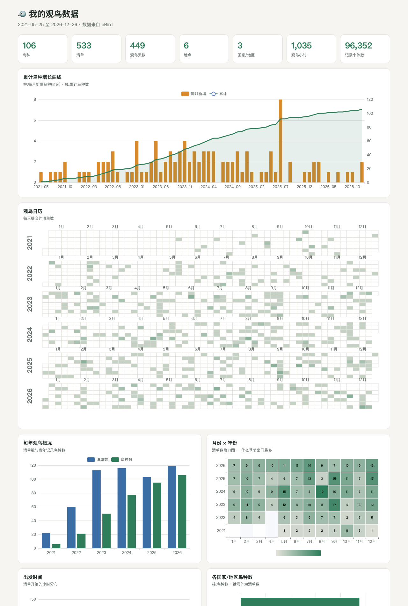
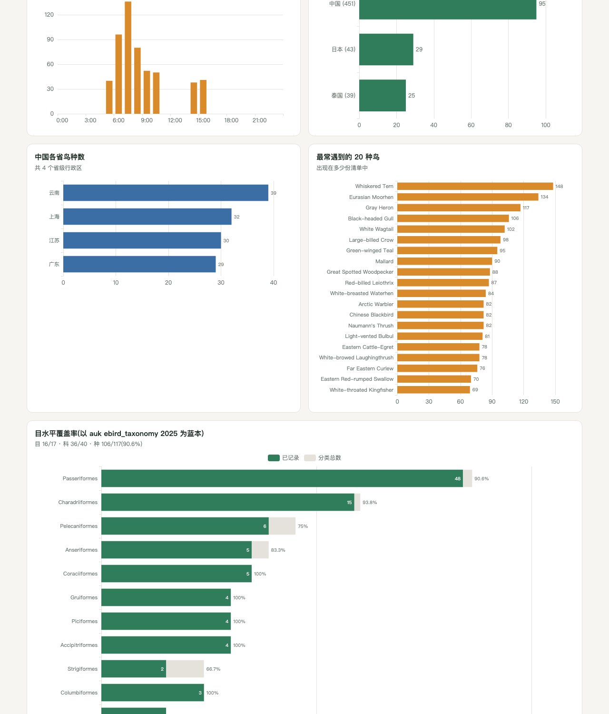
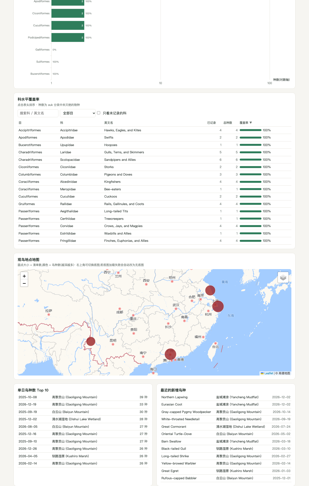

# eBird 个人观鸟数据仪表盘

把 eBird 导出的 `MyEBirdData.csv` 变成**单文件、可离线打开的观鸟数据仪表盘**:
物种增长曲线、观鸟日历、时间/空间分布、目与科覆盖率、地点地图,全部内嵌在一个 `dashboard.html` 里。

- 输入:一份 `MyEBirdData.csv`(eBird → My eBird → Download My Data)
- 输出:`dashboard.html`(单文件)+ `data.json` / `coverage.json` / `family_coverage.csv`
- 依赖:Python 3.8+ 和 pandas;目/科覆盖率额外需要 R 的 [auk](https://github.com/CornellLabofOrnithology/auk)(可选,没有就自动跳过)

**在线演示:https://xingjh-1998.github.io/ebird-dashboard/**

> 演示站用的是 `demo/` 里的**合成数据**(虚构地点 + 随机清单,`tools/make_demo.py` 生成),不含任何真实观鸟记录。





## 功能一览

### 1. 概览 KPI
鸟种数、清单数、观鸟天数、地点数、国家/地区数、观鸟小时、记录个体数、数据起止日期。

### 2. 时间维度
- **累计鸟种增长曲线**:柱 = 每月新增 lifer,线 = 累计物种数,支持滚轮/拖拽缩放
- **观鸟日历**:按年排布的全日历年热力图,每格 = 当天清单数,一眼看出什么季节出门最多
- **每年观鸟概况**:逐年清单数 + 当年记录鸟种数
- **月份 × 年份热力图**:12 个月 × 各年份的清单数矩阵,带数值标注
- **出发时间分布**:清单开始时刻(12 小时制)转成 0–23 点直方图

### 3. 空间维度
- **观鸟地点地图**(Leaflet):每个地点一个圆点,**点大小 = 清单数,颜色深浅 = 鸟种数**;点开显示地点名/清单数/鸟种数,可切换 **高德地图 / OpenStreetMap / 无底图**
- **各国家/地区鸟种数**:横向条形图,标签附带清单数
- **中国各省鸟种数**:按省级行政区排名,仅在数据里有 `CN` 记录时显示

### 4. 分类学覆盖(需 auk)
- **目水平覆盖率**:对数横轴,"已记录 vs 分类总数"双柱 + 百分比,悬停显示科数进度
- **科水平覆盖率表格**:已记录/总种数/覆盖率进度条,支持关键词搜索、按目筛选、只看未记录的科、点表头排序
- 物种归科四级兜底:学名 → 英文名 → 同属推断 → 手工映射表(`GENUS_FAMILY`)

### 5. 榜单与导出
- 最常遇到的 20 种鸟(出现在多少份清单中)
- 单日鸟种数 Top 10(日期 + 地点)
- 最近新增的 12 个鸟种(物种 + 地点 + 日期)
- 输出 `data.json`,可直接拿去做别的可视化/二次开发

### 6. 工程细节
- **单文件输出**:CSS/JS/数据全部内嵌,发给朋友双击就能看
- **自动降级**:Leaflet 加载失败 → 退化为内置经纬度散点图;底图瓦片连续失败 → 自动切"无底图",不会白屏
- **深色模式**:跟随系统 `prefers-color-scheme`
- **响应式**:窄屏下双列布局自动变单列;日历、省份图高度随数据量自适应

## 快速开始

```bash
git clone https://github.com/XingJH-1998/ebird-dashboard.git
cd ebird-dashboard
pip install -r requirements.txt        # 只需要 pandas

make site          # 用演示数据生成,输出 docs/index.html
open docs/index.html
```

用自己的数据:

```bash
# 1. eBird → My eBird → Download My Data → MyEBirdData.csv
# 2. 建议放在仓库目录之外,避免误提交
python3 ebird_dashboard.py ~/Downloads/MyEBirdData.csv -o ~/ebird-out
open ~/ebird-out/dashboard.html
```

| 参数 | 说明 |
| --- | --- |
| `csv` | eBird 导出的 `MyEBirdData.csv`(必填) |
| `-o, --out` | 输出目录,默认 `dashboard` |
| `--taxonomy` | auk `ebird_taxonomy` 导出的 CSV;不传则尝试用本机 R + auk 自动导出 |

## 数据来源

必需列:`Submission ID`、`Common Name`、`Scientific Name`、`Count`、`State/Province`、`Location ID`、`Location`、`Latitude`、`Longitude`、`Date`、`Time`、`Duration (Min)`(缺列会直接报错提示)。

## 目/科覆盖率(可选)

需要 auk 的分类表,三种方式任选:

1. 本机装了 R 和 `auk` 包 → 脚本自动调用 `Rscript` 导出
2. 手动导出后传入:
   ```r
   write.csv(auk::ebird_taxonomy, "tax.csv", row.names = FALSE)
   ```
   ```bash
   python3 ebird_dashboard.py MyEBirdData.csv --taxonomy tax.csv
   ```
3. 都没有 → 自动跳过这一部分,页面上对应卡片会被隐藏

演示站用的是 `demo/taxonomy.csv`(从 auk 分类表中挑出的 40 个科、117 种常见东亚鸟类)。

## 输出说明

| 文件 | 内容 |
| --- | --- |
| `dashboard.html` | 单文件网页,数据已内嵌,直接浏览器打开 |
| `data.json` | 页面用到的全部统计结果(KPI、月度、逐年、日历、地图点、榜单等) |
| `coverage.json` | 目/科覆盖率数据(仅在有 auk 分类时生成) |
| `family_coverage.csv` | 目/科覆盖率表格,Excel 可直接打开 |

## 统计口径

- **只统计"种"**:剔除 `sp.`、斜杠种(如 `A/B`)、杂交种(`×`/hybrid)、家养型(`Domestic`);亚种**合并到种**(取学名前两词)
- **家鸽/岩鸽**(`Columba livia`)不计入
- **物种计数按 Submission ID 去重**:同一份清单里重复出现的物种只算一次
- **鸟种数**是"该年/累计出现过"的物种数,不是当年新增
- 地点使用 eBird 的 `Location ID` 聚合,坐标为原始经纬度(保留 4 位小数)

## 项目结构

```
.
├── ebird_dashboard.py      # 生成器:读取 CSV → 统计 → 渲染单文件网页
├── demo/
│   ├── MyEBirdData.csv     # 合成演示数据(虚构,可重新生成)
│   └── taxonomy.csv        # 演示用的 auk 分类子集
├── tools/make_demo.py      # 合成数据生成器
├── docs/                   # GitHub Pages 站点(index.html)+ 截图
├── Makefile                # make site / make dashboard / make demo / make clean
├── requirements.txt
└── .gitignore
```

## 数据隐私(重要)

页面和 `data.json` 会包含**你所有观鸟地点的经纬度、日期和清单内容**,足以推断出你家附近和日常活动范围。

- **不要把真实的 `MyEBirdData.csv` 提交到这个仓库**(`.gitignore` 已忽略常见位置,但自己也要注意)
- 想公开分享时:要么只发截图,要么先做坐标模糊/删掉地图卡片,要么像本站一样用合成数据做演示
- 公开仓库的历史一旦推上去就很难彻底删除,涉及个人数据时务必先想清楚

## 局限 / 可以继续做

- 图表库、地图库和底图都走 CDN,离线打开会缺图(地图会自动降级为散点图)
- 目水平覆盖率标题里的分类版本年份是写死的
- 尚未支持:多份 CSV 合并、按季节/迁徙类型分组、eBird 热点对比、GitHub Actions 自动构建

## 技术栈

Python + pandas(统计)· ECharts 5.5(图表)· Leaflet 1.9 + 高德/OSM(地图)· auk ebird_taxonomy(分类)
